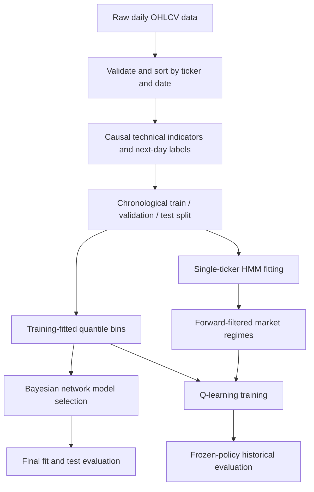

# Probabilistic Stock Trading Agent

**Bayesian networks · Time-series feature engineering · Hidden Markov models · Q-learning**

A Python research project exploring probabilistic next-day stock-direction prediction and sequential trading decisions. The system turns daily equity observations into technical indicators, estimates conditional probabilities with Bayesian networks, analyzes latent market regimes with a Gaussian Hidden Markov model, and experiments with an interpretable Q-learning agent.

The project emphasizes **reproducible experiments, chronological evaluation, and modular model implementations**.

## Project at a glance

| Component | Implementation |
| --- | --- |
| Historical data | 93,612 source observations across 31 stocks, 2006–2017 |
| Feature engineering | ATR, RSI, MACD, moving averages, Bollinger Bands, and price-normalized returns and ranges |
| Probabilistic prediction | Baseline and enhanced discrete Bayesian networks with BDeu smoothing |
| Regime analysis | Gaussian HMM with forward-filtered state inference |
| Trading experiment | Long-or-flat Q-learning agent with next-open execution and transaction costs |
| Evaluation | Chronological training/validation/test periods and classification metrics |

### System architecture



Each ticker's indicators and next-day labels are computed independently. Date boundaries are shared across tickers, so the partitions correspond to actual historical market periods.
An experiment rejects a ticker with no usable validated history or without
observations in each chronological partition, and reports ticker coverage for
training, validation, and test separately.

## Core implementations

### 1. Bayesian-network prediction

The supervised target is whether the **next observed trading day's closing price** is higher than the current day's close:

$$
\mathrm{Trend}_t = \mathbf{1}\left[\mathrm{Close}_{t+1} > \mathrm{Close}_t\right].
$$

Two discrete Bayesian networks support a controlled feature-set comparison:

| Model | Features |
| --- | --- |
| Baseline | Daily close-to-close return, intraday return, daily high-low range (normalized by opening price) |
| Enhanced | Baseline features plus MACD normalized by closing price |

Both use an explicit feature-to-target directed graph. Price-relative features allow observations from differently priced stocks to share meaningful bins. The training workflow estimates conditional probability tables with a **Bayesian Dirichlet equivalent uniform (BDeu) prior** and selects equivalent sample size using validation data.

To make the comparison reproducible, the same chronological partitions and training-fitted discretization are used throughout. The final report includes accuracy, balanced accuracy, precision, recall, F1, ROC AUC, and a majority-class benchmark.

**Implementation:** [`scripts/model_training.py`](scripts/model_training.py)

### 2. Hidden Markov market regimes

The Gaussian HMM models technical-indicator observations as emissions from latent market states. Its inference routine performs **forward filtering**, estimating the regime at each date from information available through that date. Model parameters are fitted on the training period and can then be applied to later observations.

The [HMM and RL notebook](notebooks/HMM_and_RL_Experiments.ipynb) illustrates regime assignments for a single ticker, including a separate later period.

**Implementation:** [`scripts/hmm_integration.py`](scripts/hmm_integration.py)

### 3. Q-learning trading simulator

The tabular Q-learning agent considers **buy, sell, and hold**, allowing buys only when flat and sells only when invested. States combine training-binned daily return and RSI, a forward-filtered market regime, and the current position. Decisions use completed daily observations; orders execute at the **next session's open**. A single-symbol simulation tracks a long-or-flat position, overnight gaps, intraday price changes, and transaction costs.

The experiment trains on an earlier historical segment and evaluates the frozen policy on later observations, alongside a one-share, next-open buy-and-hold comparison.
Both outcomes are marked to the final observed close. A share still held at
that point remains open, so the displayed P/L excludes a hypothetical final
sale and its transaction fee.

**Implementation:** [`scripts/rl_agent.py`](scripts/rl_agent.py)

## Historical evaluation results

On the included 31-ticker dataset, both Bayesian networks were evaluated on the
same later test period, after validation-based parameter selection:

| Predictor | Test accuracy | Test ROC AUC |
| --- | ---: | ---: |
| Training-majority benchmark | **52.06%** | — |
| Baseline Bayesian network | 51.69% | 0.515 |
| Enhanced Bayesian network | 51.08% | 0.507 |

Neither Bayesian network beat the majority-class benchmark on this holdout.
In the separate AAPL trading notebook, the frozen Q-learning policy earned
**+$0.30** in one-share, dollar-denominated holdout P/L, compared with
**+$54.86** for the next-open buy-and-hold comparator. These historical
experiments demonstrate the implementation and its limitations; they do not
establish predictive superiority or deployable trading profitability.

## Reproduce the experiments

**Requirements:** Python 3.10+ and Git.

```bash
git clone https://github.com/ryanrowe2/StockTradingAI-Project.git
cd StockTradingAI-Project
git switch Milestone3
python -m venv .venv
```

Activate the environment (`source .venv/bin/activate` on macOS/Linux or `.venv\Scripts\activate` on Windows), then:

```bash
python -m pip install -r requirements.txt

# Prepare technical indicators and ticker-safe next-day labels.
python scripts/data_processing.py

# Train, select, and evaluate Bayesian networks on the historical dataset.
python scripts/model_training.py

# Optional: run a quicker single-ticker experiment.
python scripts/model_training.py --ticker AAPL --output data/generated/aapl_model_metrics.json
```

Generated feature tables and model metrics are saved under `data/generated/`. These artifacts can be regenerated directly from the included raw data.
The input validator raises a clear error if all valid price bars for any ticker
are discarded, rather than silently excluding that ticker.

For an exact version snapshot of the verified **Python 3.12 / Linux** experiment
environment, install `requirements-repro-py312.txt` instead of the flexible
requirements files. It pins both direct and transitive dependencies; use
`requirements.txt` / `requirements-dev.txt` for other supported environments.

For tests, install the development requirements and run:

```bash
python -m pip install -r requirements-dev.txt
python -m pytest tests -q
```

### Interactive notebooks

| Notebook | Purpose |
| --- | --- |
| [Exploratory Data Analysis](notebooks/EDA_Preprocessing.ipynb) | Describe the historical dataset, missingness, distributions, and price outliers |
| [Model Training & Evaluation](notebooks/Model_Training_Evaluation.ipynb) | Reproduce the chronological Bayesian-network comparison |
| [HMM & Q-learning Experiments](notebooks/HMM_and_RL_Experiments.ipynb) | Visualize filtered regimes and compare an experimental trading policy with buy-and-hold |

The notebooks include saved output tables and plots for immediate viewing on GitHub. To run them interactively, optionally install and launch JupyterLab from the repository root after activating the project environment:

```bash
python -m pip install jupyterlab
jupyter lab
```

Open the files in `notebooks/` and select the project environment as the kernel. Reproduce the published outputs with `python -m scripts.refresh_notebooks`. See the [experiment reproduction guide](docs/README_experiments.md) for technical details and exact experiment settings.

## Repository structure

```text
StockTradingAI-Project/
├── data/
│   ├── raw/                       # Third-party historical CSVs and source notice
│   └── generated/                 # Regenerable outputs (ignored by Git)
├── docs/
│   └── README_experiments.md      # Reproduction and methodology guide
├── notebooks/                     # EDA, model evaluation, HMM / RL experiments
├── scripts/
│   ├── date_validation.py        # Explicit daily calendar date validation
│   ├── data_processing.py         # Input validation and causal features
│   ├── technical_indicators.py    # Per-symbol technical indicators
│   ├── model_training.py          # Bayesian networks and time-based evaluation
│   ├── hmm_integration.py         # Gaussian HMM and forward filtering
│   ├── rl_agent.py                # Position-aware trading environment / Q-learning
│   └── refresh_notebooks.py       # Reproducible notebook tables and charts
├── tests/                         # Automated pipeline regression tests
├── .github/workflows/             # Automated verification on pushes / PRs
├── requirements.txt
├── requirements-repro-py312.txt   # Tested, pinned Python 3.12/Linux environment
├── requirements-dev.txt
└── LICENSE                        # MIT license for original software and docs
```

## Dataset and references

- **Data:** [Stock Time Series 20050101 to 20171231](https://www.kaggle.com/datasets/szrlee/stock-time-series-20050101-to-20171231). The included combined CSV spans January 2006 through December 2017.
- **Bayesian networks:** [pgmpy](https://pgmpy.org/)
- **Hidden Markov models:** [hmmlearn](https://hmmlearn.readthedocs.io/)
- **Data processing and evaluation:** [pandas](https://pandas.pydata.org/) and [scikit-learn](https://scikit-learn.org/)

## License

Original project software and documentation are licensed under the
[MIT License](LICENSE), copyright © 2026 Ryan Rowe. The historical CSVs in
[`data/raw/`](data/raw/README.md) are third-party material and are not included
under this MIT license; consult the source dataset's terms for their use.

**Ryan Rowe** · B.S., Mathematics–Computer Science, University of California San Diego
