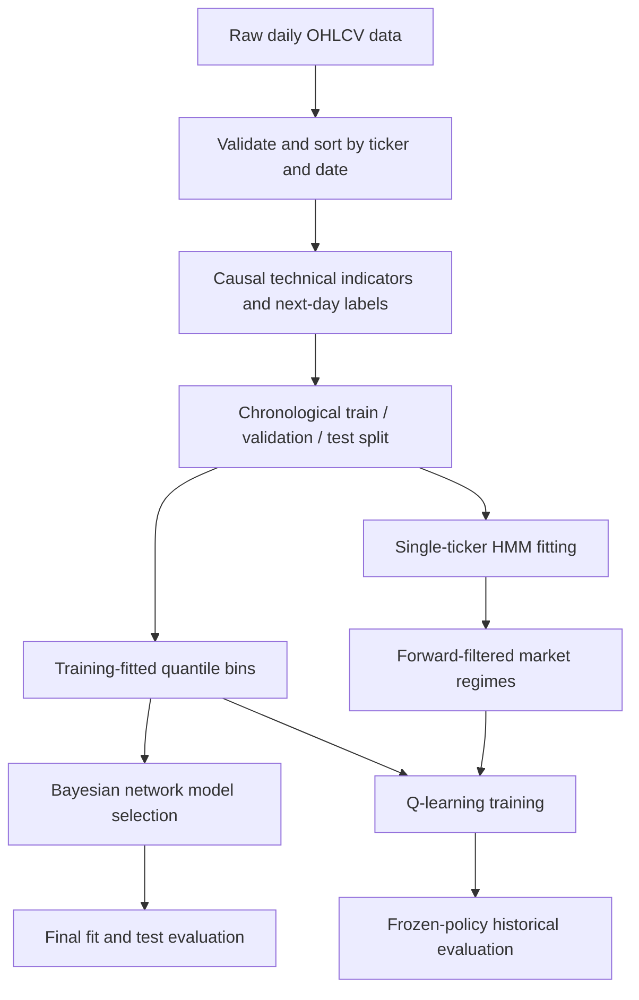

# Probabilistic Stock Trading Agent

**Bayesian networks · Time-series feature engineering · Hidden Markov models · Q-learning**

A Python research project exploring probabilistic next-day stock-direction prediction and sequential trading decisions. The system turns daily equity observations into technical indicators, estimates conditional probabilities with Bayesian networks, analyzes latent market regimes with a Gaussian Hidden Markov model, and experiments with an interpretable Q-learning agent.

The project emphasizes **reproducible experiments, chronological evaluation, and modular model implementations**.

## Project at a glance

| Component | Implementation |
| --- | --- |
| Historical data | 93,612 source observations across 31 stocks, 2006–2017 |
| Feature engineering | ATR, RSI, MACD, moving averages, Bollinger Bands, and lagged returns |
| Probabilistic prediction | Baseline and enhanced discrete Bayesian networks with BDeu smoothing |
| Regime analysis | Gaussian HMM with forward-filtered state inference |
| Trading experiment | Long-or-flat Q-learning agent with next-open execution and transaction costs |
| Evaluation | Chronological training/validation/test periods and classification metrics |

### System architecture



Each ticker's indicators and next-day labels are computed independently. Date boundaries are shared across tickers, so the partitions correspond to actual historical market periods.

## Core implementations

### 1. Bayesian-network prediction

The supervised target is whether the **next observed trading day's closing price** is higher than the current day's close:

$$
\mathrm{Trend}_t = \mathbf{1}\left[\mathrm{Close}_{t+1} > \mathrm{Close}_t\right].
$$

Two discrete Bayesian networks support a controlled feature-set comparison:

| Model | Features |
| --- | --- |
| Baseline | Open, High, Low |
| Enhanced | Open, High, Low, Average True Range, daily return |

Both use an explicit feature-to-target directed graph. The training workflow estimates conditional probability tables with a **Bayesian Dirichlet equivalent uniform (BDeu) prior** and selects equivalent sample size using validation data.

To make the comparison reproducible, the same chronological partitions and training-fitted discretization are used throughout. The final report includes accuracy, balanced accuracy, precision, recall, F1, ROC AUC, and a majority-class benchmark.

**Implementation:** [`scripts/model_training.py`](scripts/model_training.py)

### 2. Hidden Markov market regimes

The Gaussian HMM models technical-indicator observations as emissions from latent market states. Its inference routine performs **forward filtering**, estimating the regime at each date from information available through that date. Model parameters are fitted on the training period and can then be applied to later observations.

The [HMM and RL notebook](notebooks/HMM_and_RL_Experiments.ipynb) illustrates regime assignments for a single ticker, including a separate later period.

**Implementation:** [`scripts/hmm_integration.py`](scripts/hmm_integration.py)

### 3. Q-learning trading simulator

The tabular Q-learning agent explores three actions: **buy, sell, and hold**. Decisions use completed daily observations; orders execute at the **next session's open**. A single-symbol simulation tracks a long-or-flat position, overnight gaps, intraday price changes, and transaction costs.

The experiment trains on an earlier historical segment and evaluates the frozen policy on later observations, alongside a one-share, next-open buy-and-hold comparison.

**Implementation:** [`scripts/rl_agent.py`](scripts/rl_agent.py)

## Reproduce the experiments

**Requirements:** Python 3.10+ and Git.

```bash
git clone https://github.com/ryanrowe2/StockTradingAI-Project.git
cd StockTradingAI-Project
git switch Milestone3
python -m venv .venv
```

Activate the environment (`source .venv/bin/activate` on macOS/Linux or `.venv\Scripts\activate` on Windows), then:

```bash
python -m pip install -r requirements.txt

# Prepare technical indicators and ticker-safe next-day labels.
python scripts/data_processing.py

# Train, select, and evaluate Bayesian networks on the historical dataset.
python scripts/model_training.py

# Optional: run a quicker single-ticker experiment.
python scripts/model_training.py --ticker AAPL
```

Generated feature tables and model metrics are saved under `data/generated/`. These artifacts can be regenerated directly from the included raw data.

For tests, install the development requirements and run:

```bash
python -m pip install -r requirements-dev.txt
python -m pytest tests -q
```

### Interactive notebooks

| Notebook | Purpose |
| --- | --- |
| [Exploratory Data Analysis](notebooks/EDA_Preprocessing.ipynb) | Describe the historical dataset, missingness, distributions, and price outliers |
| [Model Training & Evaluation](notebooks/Model_Training_Evaluation.ipynb) | Reproduce the chronological Bayesian-network comparison |
| [HMM & Q-learning Experiments](notebooks/HMM_and_RL_Experiments.ipynb) | Visualize filtered regimes and compare an experimental trading policy with buy-and-hold |

The notebooks include saved output tables and plots for immediate viewing on GitHub. Open them from the `notebooks/` folder in Jupyter with the project environment selected. Reproduce their outputs with `python -m scripts.refresh_notebooks`. See the [experiment reproduction guide](docs/README_experiments.md) for technical details and exact experiment settings.

## Repository structure

```text
StockTradingAI-Project/
├── data/
│   ├── raw/                       # Historical source CSVs
│   └── generated/                 # Regenerable outputs (ignored by Git)
├── docs/
│   └── README_experiments.md      # Reproduction and methodology guide
├── notebooks/                     # EDA, model evaluation, HMM / RL experiments
├── scripts/
│   ├── data_processing.py         # Input validation and causal features
│   ├── technical_indicators.py    # Per-symbol technical indicators
│   ├── model_training.py          # Bayesian networks and time-based evaluation
│   ├── hmm_integration.py         # Gaussian HMM and forward filtering
│   ├── rl_agent.py                # Position-aware trading environment / Q-learning
│   └── refresh_notebooks.py       # Reproducible notebook tables and charts
├── tests/                         # Automated pipeline regression tests
├── .github/workflows/             # Automated verification on pushes / PRs
├── requirements.txt
└── requirements-dev.txt
```

## Dataset and references

- **Data:** [Stock Time Series 20050101 to 20171231](https://www.kaggle.com/datasets/szrlee/stock-time-series-20050101-to-20171231). The included combined CSV spans January 2006 through December 2017.
- **Bayesian networks:** [pgmpy](https://pgmpy.org/)
- **Hidden Markov models:** [hmmlearn](https://hmmlearn.readthedocs.io/)
- **Data processing and evaluation:** [pandas](https://pandas.pydata.org/) and [scikit-learn](https://scikit-learn.org/)

**Ryan Rowe** · B.S., Mathematics–Computer Science, University of California San Diego
