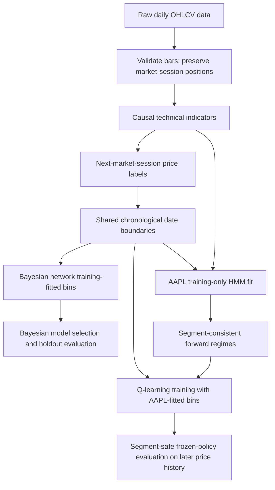

# Probabilistic Stock Trading Agent

**Bayesian networks · Time-series feature engineering · Hidden Markov models · Q-learning**

A Python research project exploring probabilistic next-session stock-direction prediction and sequential trading decisions. The system turns daily equity observations into technical indicators, estimates conditional probabilities with Bayesian networks, analyzes latent market regimes with a Gaussian Hidden Markov model, and experiments with an interpretable Q-learning agent.

The project emphasizes **reproducible experiments, chronological evaluation, and modular model implementations**.

## Project at a glance

| Component | Implementation |
| --- | --- |
| Historical data | 93,612 source observations across 31 stocks, 2006–2017 |
| Feature engineering | ATR, RSI, MACD, moving averages, Bollinger Bands, and price-normalized returns and ranges |
| Probabilistic prediction | Baseline and enhanced discrete Bayesian networks with BDeu smoothing |
| Regime analysis | Gaussian HMM with forward-filtered state inference |
| Trading experiment | Long-or-flat Q-learning agent with next-open execution and transaction costs |
| Evaluation | Chronological training/validation/test periods and classification metrics |

### System architecture



Each ticker's indicators and next-session labels are computed independently. Ticker
identifiers are normalized consistently, including for direct indicator calls;
literal symbols such as `NA` are preserved during CSV loading. Date boundaries
are shared across the Bayesian and AAPL trading experiments, so their partitions
correspond to the same historical market periods. All bundled ticker CSVs use
the observed-session calendar of the complete 31-stock source. It retains
dates attached to valid ticker identifiers even when their prices are unusable,
but excludes malformed dates and invalid ticker identifiers.
Date-only custom equity data from 1971 onward use scheduled NYSE sessions,
including effective-dated holidays, 1972–1980 presidential Election Day
closures, and documented exceptional full-day closures. Explicitly NYSE-labeled
inputs reject observations on known closed-market dates even when session
ordinals are supplied. An optional
`Exchange` column groups stocks on the same market, so an observed exchange
session can expose a missing bar in another stock without contaminating a
different exchange's calendar. Without `Exchange`, observed extra weekdays are
retained only for the ticker that traded them. Callers can also supply verified
`Session_Number` metadata, required for historical pre-1971 NYSE dates where
automatic inference cannot safely reconstruct the older schedule. Close-to-close daily
returns, RSI changes, and prediction targets do not bridge missing sessions.
For `NYSE`/`XNYS` observations from 1971 onward, supplied ordinals must have
the same spacing as actual scheduled market sessions, so an omitted Tuesday
cannot be disguised as the next session after Monday. Verified session ordinals
also support historical NYSE Saturday trading through
its last Saturday session on May 24, 1952; later weekends are rejected.
Direct session utilities require daily dates. For raw NumPy date scalars, use
`validate_raw_bar_records(records)` **before constructing a pandas DataFrame**:
it rejects year-, month-, or week-precision dates rather than inventing a day.
Ordinary pandas construction may silently expand such scalars into a complete
timestamp, permanently discarding their original precision; a validator
receiving that already-converted DataFrame cannot reconstruct it. Therefore
`validate_bars()` rejects pandas datetime64/Timestamp dates by default;
`verified_datetime_dates=True` is an explicit attestation for callers who
independently checked their original date precision. ISO daily strings, Python
date objects, and explicit NumPy day-precision values are safe inputs to the
raw-record API. When selecting a ticker from a custom CSV, an unrelated NYSE
ticker's impossible closed-market observation is excluded from shared calendar
inference, while the selected ticker's own invalid dates are still rejected.
Direct multi-ticker indicator and trading-episode utilities infer shared
exchange calendars before splitting the source into individual stocks.
Trading episodes reject duplicate ticker/date records and sort parsed dates,
including valid non-zero-padded ISO dates.
HMM fitting uses separate complete contiguous sequences; forward filtering
restarts after incomplete observations or missing source sessions, so both use
the same boundary policy. Target dates must follow their
feature dates by exactly one recorded market session.
An experiment rejects a ticker with no usable validated history or without
observations in each chronological partition, and reports ticker coverage for
training, validation, and test separately.

## Core implementations

### 1. Bayesian-network prediction

The supervised target is whether the **next market session's closing price** is higher than the current session's close. Observations without a valid next-session close are excluded:

$$
\mathrm{Trend}_t = \mathbf{1}\left[\mathrm{Close}_{t+1} > \mathrm{Close}_t\right].
$$

Two discrete Bayesian networks support a controlled feature-set comparison:

| Model | Features |
| --- | --- |
| Baseline | Consecutive-session close-to-close return, intraday return, daily high-low range (normalized by opening price) |
| Enhanced | Baseline features plus MACD normalized by closing price |

Both use an explicit feature-to-target directed graph. Price-relative features allow observations from differently priced stocks to share meaningful bins. The training workflow estimates conditional probability tables with a **Bayesian Dirichlet equivalent uniform (BDeu) prior** and selects equivalent sample size using validation data.

Both feature sets use the same chronological partitions and comparable
observations. Feature preparation requires only the enhanced model's columns;
it does not discard rows because unrelated diagnostic indicators are missing.
The `prepare_features(..., features=...)` option also permits a larger
baseline-only eligible sample. For validation-based model selection, quantile
bins are fitted on training data only. After selecting the prior strength, the
bins and model are refitted on combined training and validation observations
before final test evaluation. The report includes accuracy, balanced accuracy,
precision, recall, F1, ROC AUC, and a majority-class benchmark.

**Implementation:** [`scripts/model_training.py`](scripts/model_training.py)

### 2. Hidden Markov market regimes

The Gaussian HMM models technical-indicator observations as emissions from latent market states. Its inference routine performs **forward filtering**, estimating the regime at each date from information available through that date. During fitting, complete-indicator training observations are divided into contiguous source-market-session segments so the model does not learn fictitious one-session transitions across missing bars. Filtering restarts from the learned initial-state distribution after the same gaps, matching the fitted independent-sequence treatment. The fitting helper records the ordered indicator names and rejects incompatible inference feature orders. Single-ticker inputs normalize ticker spelling and case consistently with the data pipeline.

The [HMM and RL notebook](notebooks/HMM_and_RL_Experiments.ipynb) illustrates regime assignments for a single ticker, including a separate later period.

**Implementation:** [`scripts/hmm_integration.py`](scripts/hmm_integration.py)

### 3. Q-learning trading simulator

The tabular Q-learning agent considers **buy, sell, and hold**, allowing buys only when flat and sells only when invested. States combine training-binned daily return and RSI, a forward-filtered market regime, and the current position. State components must be actual integers, and transition dimensions, position changes, and Q-value updates are checked for validity. Decisions use completed daily observations; orders execute at the **next session's open**. A single-symbol simulation requires consecutive recorded market sessions; training splits at missing feature sessions rather than treating weeks as one trading step. The simulator tracks overnight gaps, intraday price changes, and transaction costs, rejecting nonfinite step and cumulative rewards.

The experiment trains across separate contiguous episodes in an earlier historical period and evaluates the frozen policy on later observations, alongside a one-share, next-open buy-and-hold comparison. Both training and test episodes restart after an absent market session, so no trade is executed across an unobserved multi-session gap.
Both outcomes are marked to the final validated source close, including the
terminal trading session that has no next-day prediction label. A share still held at
that point remains open, so the displayed P/L excludes a hypothetical final
sale and its transaction fee.

**Implementation:** [`scripts/rl_agent.py`](scripts/rl_agent.py)

## Historical evaluation results

On the included 31-ticker dataset, both Bayesian networks were evaluated on the
same later test period, after validation-based parameter selection:

| Predictor | Test accuracy | Test ROC AUC |
| --- | ---: | ---: |
| Training-majority benchmark | **52.09%** | — |
| Baseline Bayesian network | 51.72% | 0.511 |
| Enhanced Bayesian network | 50.96% | 0.506 |

Neither Bayesian network beat the majority-class benchmark on this holdout.
In the separate AAPL trading notebook, the frozen Q-learning policy earned
**+$29.10** in one-share, dollar-denominated holdout P/L, compared with
**+$53.07** for the next-open buy-and-hold comparator. These historical
experiments demonstrate the implementation and its limitations; they do not
establish predictive superiority or deployable trading profitability.

For a signal acted upon at the *next open*, an additional supervised target
tests whether that session's close is above its own open. This isolates an
intraday direction observable after a next-open entry instead of counting
an overnight move that occurs before the order executes. It does not change
the original published close-to-close task or its results. An expanding-window
evaluation additionally measures performance on five successive, nonoverlapping
holdouts, with paired block-bootstrap intervals for accuracy differences
against the majority baseline. Neither alternative target construction nor
additional validation should be interpreted as a guaranteed performance gain.

| Five-fold walk-forward target | Majority accuracy | Baseline BN | Enhanced BN | Baseline lift, 95% date-block interval |
| --- | ---: | ---: | ---: | ---: |
| Close-to-close | 51.67% | 51.96% | 51.69% | −0.55 to +1.11 percentage points |
| Next-open-to-close | 51.40% | 51.68% | 51.30% | −0.48 to +1.03 percentage points |

Both baseline accuracy lifts are small and their intervals include zero. The
bootstrap validates binary labels, strictly daily dates, and finite probability
values in [0, 1], and requires at least two distinct date blocks before
reporting intervals. Fold feasibility is checked before model fitting. This
provides additional historical evidence without establishing a reproducible
advantage over the naive classifier. The full fold-by-fold scores and bootstrap
configuration are reproduced by the walk-forward command below.

## Reproduce the experiments

**Requirements:** Python 3.10–3.12 and Git.

```bash
git clone https://github.com/ryanrowe2/StockTradingAI-Project.git
cd StockTradingAI-Project
git switch Milestone3
python -m venv .venv
```

Activate the environment (`source .venv/bin/activate` on macOS/Linux or `.venv\Scripts\activate` on Windows), then:

```bash
python -m pip install -r requirements.txt

# Prepare technical indicators and ticker-safe next-session labels.
python scripts/data_processing.py

# Train, select, and evaluate Bayesian networks on the historical dataset.
python scripts/model_training.py

# Optional: run a quicker single-ticker experiment with its own split dates.
python scripts/model_training.py --ticker AAPL --output data/generated/aapl_model_metrics.json

# Evaluate an execution-aligned next-open-to-close prediction target.
python -m scripts.model_training --target next_open_to_close --output data/generated/executable_target_metrics.json

# Five expanding training windows with distinct out-of-sample test periods.
python -m scripts.walk_forward_evaluation --target next_open_to_close --output data/generated/executable_walk_forward_metrics.json
```

Generated feature tables and model metrics are saved under `data/generated/`. These artifacts can be regenerated directly from the included raw data.
The input validator raises a clear error if all valid price bars for any ticker
are discarded, rather than silently excluding that ticker.
When `--ticker` is specified, selection happens before price-bar validation,
so invalid records belonging only to other symbols do not block the experiment.
The bundled reference calendar independently ignores malformed source dates
and invalid ticker identifiers; an invalid OHLCV bar on an otherwise valid
market date still preserves that session's position for gap detection.
CSV parsing preserves legitimate ticker strings such as `NA`, which pandas
otherwise interprets as missing values, while rejecting explicit placeholders
such as `N/A`, `NaN`, `NULL`, and `<NA>`, plus malformed symbols. The same
ticker-name validation applies to
direct indicator, HMM, and trading-environment calls. Of the 93,612 source
records, 93,435 pass OHLCV validation; 177 incomplete or contradictory rows
are excluded without modifying the raw files.
An additional `Session_Number` column preserves market-session positions through
this exclusion. The bundled individual stock files use the complete dataset's
observed-session calendar. Other CSVs, including new files inside `data/raw/`,
use an NYSE-holiday-aware calendar that retains explicitly observed extra
weekdays within a declared `Exchange`, or within one ticker when no exchange
is specified. Full-source dates anchor inferred ordinals even when loading a
ticker subset. Supplied session positions are checked for chronological
uniqueness within each ticker or declared exchange and for valid daily dates,
including historically verified Saturday trading before summer 1952;
large unsigned positions are compared as exact integers, without float loss.
Identical duplicate ticker/date records are rejected, and empty ordinal
sequences produce empty adjacency flags.
A close-to-close return crossing an excluded session is unavailable for
single-day modeling rather than compressed into one day's return. Such a row
also receives no next-session direction label and is excluded from supervised
training and evaluation.
The optional AAPL-only model run derives its chronological split boundaries
from AAPL's own eligible dates: in this version, training ends 2013-04-01 and
validation ends 2015-08-17, versus 2013-03-28 and 2015-08-13 in the 31-stock
comparison. Its metrics are therefore not an identical-period replication.

For an exact version snapshot of the verified **Python 3.12 / Linux** experiment
environment, install `requirements-repro-py312.txt` instead of the flexible
requirements files. It pins both direct and transitive dependencies; use
`requirements.txt` / `requirements-dev.txt` for other supported environments.

For tests, install the development requirements and run:

```bash
python -m pip install -r requirements-dev.txt
python -m pytest tests -q
python -m ruff check scripts tests --isolated --select E4,E7,E9,F,B
```

### Interactive notebooks

| Notebook | Purpose |
| --- | --- |
| [Exploratory Data Analysis](notebooks/EDA_Preprocessing.ipynb) | Audit source-data quality, compare per-ticker return distributions and outliers, and chart AAPL closing prices |
| [Model Training & Evaluation](notebooks/Model_Training_Evaluation.ipynb) | Reproduce the chronological Bayesian-network comparison |
| [HMM & Q-learning Experiments](notebooks/HMM_and_RL_Experiments.ipynb) | Visualize filtered regimes and compare an experimental trading policy with buy-and-hold |

The notebooks include saved output tables and plots for immediate viewing on GitHub. To run them interactively, optionally install and launch JupyterLab from the repository root after activating the project environment:

```bash
python -m pip install jupyterlab
jupyter lab
```

Open the files in `notebooks/` and select the project environment as the kernel. Reproduce the published outputs with `python -m scripts.refresh_notebooks`. See the [experiment reproduction guide](docs/README_experiments.md) for technical details and exact experiment settings.
The notebook reproduction helper captures stdout, stderr, rich `display()` and
expression results, and Matplotlib figures in execution order. It restores the
caller's working directory and import path, excludes existing figures from
capture, and cleans up newly created figures if a cell fails.
The EDA notebook uses the same bundled-session calendar and validated returns
as the modeling pipeline; its source path works from both the repository root
and the notebook folder.
The HMM/RL notebook also measures fixed-policy sensitivity to 0, 10, and 25
basis points of execution slippage. The environment exposes per-episode fees,
trade counts, dollar drawdown, and exposure without assuming a terminal sale.
These are intentionally simplified one-share scenarios; real-world spread,
market impact, liquidity, financing, and portfolio risks are not modeled.

## Repository structure

```text
StockTradingAI-Project/
├── data/
│   ├── raw/                       # Third-party historical CSVs and source notice
│   └── generated/                 # Regenerable outputs (ignored by Git)
├── docs/
│   └── README_experiments.md      # Reproduction and methodology guide
├── notebooks/                     # EDA, model evaluation, HMM / RL experiments
├── scripts/
│   ├── date_validation.py        # Explicit daily calendar date validation
│   ├── market_calendar.py        # Holiday-aware U.S. equity session positions
│   ├── price_validation.py       # Shared coherent-price checks
│   ├── session_validation.py     # Consistent market-session metadata
│   ├── ticker_validation.py      # Shared ticker-name normalization and checks
│   ├── data_processing.py         # Input validation and causal features
│   ├── technical_indicators.py    # Per-symbol technical indicators
│   ├── model_training.py          # Bayesian networks and time-based evaluation
│   ├── walk_forward_evaluation.py # Expanding holdouts and paired uncertainty intervals
│   ├── hmm_integration.py         # Gaussian HMM and forward filtering
│   ├── rl_agent.py                # Position-aware trading environment / Q-learning
│   └── refresh_notebooks.py       # Reproducible notebook tables and charts
├── tests/                         # Automated pipeline regression tests
├── .github/workflows/             # Automated verification on pushes / PRs
├── requirements.txt
├── requirements-repro-py312.txt   # Tested, pinned Python 3.12/Linux environment
├── requirements-dev.txt
└── LICENSE                        # MIT license for original software and docs
```

## Dataset and references

- **Data:** [Stock Time Series 20050101 to 20171231](https://www.kaggle.com/datasets/szrlee/stock-time-series-20050101-to-20171231). The included combined CSV spans January 2006 through December 2017.
- **Bayesian networks:** [pgmpy](https://pgmpy.org/)
- **Hidden Markov models:** [hmmlearn](https://hmmlearn.readthedocs.io/)
- **Data processing and evaluation:** [pandas](https://pandas.pydata.org/) and [scikit-learn](https://scikit-learn.org/)

## License

Original project software and documentation are licensed under the
[MIT License](LICENSE), copyright © 2026 Ryan Rowe. The historical CSVs in
[`data/raw/`](data/raw/README.md) are third-party material and are not included
under this MIT license; consult the source dataset's terms for their use.

**Ryan Rowe** · B.S., Mathematics–Computer Science, University of California San Diego
