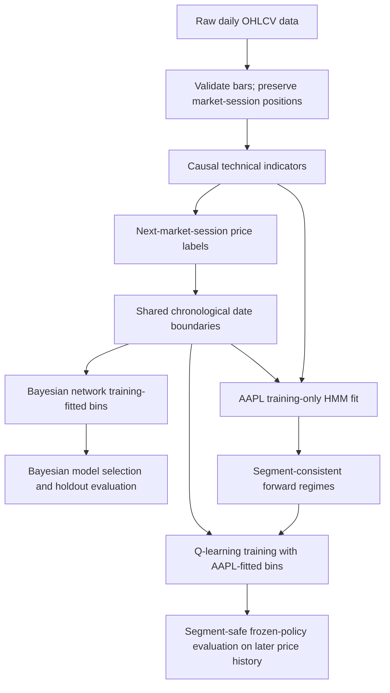

# Probabilistic Stock Trading Agent

**Research question:** Can probabilistic models and a reinforcement-learning trading simulator be evaluated reproducibly on historical market data without leaking future information into training?

**What I want reviewers to notice:** The project combines Bayesian networks, hidden Markov models, and Q-learning under chronological evaluation. The [historical research results](#historical-research-results) and [reproduction instructions](#reproduce-the-experiments) are the best starting points; benchmark comparisons and limitations matter as much as test counts.

**Scope:** Historical research software, not evidence of a profitable live trading system.

**Bayesian Networks · Hidden Markov Models · Q-Learning · Quantitative Research**

A reproducible Python research system for analyzing historical equity markets, predicting next-session price direction, identifying latent market regimes, and evaluating experimental trading decisions.

The project integrates probabilistic machine learning, time-series feature engineering, reinforcement learning, and rigorous chronological evaluation into a modular, independently tested research environment.

## Project at a Glance

| Metric | Verified Result |
|---|---|
| Historical dataset | 93,612 observations across 31 stocks (2006–2017) |
| Modeling approaches | Bayesian networks, Gaussian HMMs, tabular Q-learning |
| Automated tests | 555 passing tests on each of five CI environments |
| Branch-aware research-code coverage | 90.3% |
| Reproducibility | SHA-256-locked dependencies, validated notebooks, pinned research results |
| CI environments | Linux/Python 3.10–3.12, Windows Server 2025, macOS 15 |

## System Architecture



The research pipeline consists of three integrated modeling components:

**1. Probabilistic prediction**

Engineers historical technical indicators and trains discrete Bayesian networks using BDeu parameter estimation. Compares baseline and enhanced feature sets using chronological training, validation, and test partitions.

**2. Market regime modeling**

Uses a Gaussian Hidden Markov model to characterize latent market states, with forward-filtered inference and explicit handling of missing market sessions.

**3. Reinforcement-learning trading research**

Implements a tabular Q-learning agent with position-aware actions, next-session-open execution, transaction costs, and frozen-policy evaluation against a buy-and-hold comparator.

All components share validated market-session handling and causal feature preparation to prevent future-data leakage and inconsistent historical observations.

## Historical Research Results

**Main finding:** Neither Bayesian-network model exceeded the majority-class benchmark in the reported holdout evaluation. In the separate AAPL experiment, the frozen Q-learning policy also underperformed the buy-and-hold comparator. These findings support the rigor of the evaluation workflow, not a claim of trading advantage.

**Inspect the full evidence:** [Historical evaluation results](#historical-evaluation-results) includes model accuracy, ROC AUC, the trading comparison, expanding-window experiments, uncertainty and dataset limitations.

## Engineering and Reproducibility

- **555 automated tests** passed independently on each of five Linux, Windows, and macOS CI environments.
- **90.3% branch-aware research-code coverage**, with six additional module-specific coverage requirements.
- Versioned, SHA-256-verified dependency environments for reproducible execution.
- Verified source-data integrity across 33 CSV files, including equivalence checks against 31 original publisher files.
- Pinned experimental metrics, notebook outputs, and five-fold walk-forward results, reproduced by GitHub Actions.
- Protected release branch with verified pull-request checks and automatic cleanup of merged temporary branches.

**Verification:** [Certified GitHub Actions results](https://github.com/ryanrowe2/StockTradingAI-Project/actions/runs/43297446884)

**Data provenance:** [Historical dataset and CC0 publisher license evidence](data/raw/README.md)

**Research methodology:** [Experiment Reproduction Guide](docs/README_experiments.md)

**Implementation:** Python · pandas · NumPy · scikit-learn · pgmpy · hmmlearn · GitHub Actions

---

*Detailed architecture, modeling methodology, experimental results, reproduction instructions, and technical documentation follow below.*

## Detailed Architecture and Implementation Notes

The research pipeline explicitly validates exchange-aware market sessions and date precision, preserves ticker identity, rejects impossible source records and disguised missing sessions, and handles discontinuities consistently across indicators, HMM filtering and trading episodes. These safeguards support chronological evaluation without implying that historical market data or profitability claims are free from all selection bias.

**Technical deep dive:** [Full market-calendar, data-integrity, leakage and sequence-boundary notes](docs/engineering-notes.md). The original detailed implementation discussion is preserved there in full.

## Core implementations

### 1. Bayesian-network prediction

The supervised target is whether the **next market session's closing price** is higher than the current session's close. Observations without a valid next-session close are excluded:

$$
\mathrm{Trend}_t = \mathbf{1}\left[\mathrm{Close}_{t+1} > \mathrm{Close}_t\right].
$$

Two discrete Bayesian networks support a controlled feature-set comparison:

| Model | Features |
| --- | --- |
| Baseline | Consecutive-session close-to-close return, intraday return, daily high-low range (normalized by opening price) |
| Enhanced | Baseline features plus MACD normalized by closing price |

Both use an explicit feature-to-target directed graph. Price-relative features allow observations from differently priced stocks to share meaningful bins. The training workflow estimates conditional probability tables with a **Bayesian Dirichlet equivalent uniform (BDeu) prior** and selects equivalent sample size using validation data. Both direct network
fitting and model selection validate binary training labels before conversion
and reject invalid or empty BDeu candidate grids before fitting.

Both feature sets use the same chronological partitions and comparable
observations. Feature preparation requires only the enhanced model's columns;
it does not discard rows because unrelated diagnostic indicators are missing.
The `prepare_features(..., features=...)` option also permits a larger
baseline-only eligible sample. For validation-based model selection, quantile
bins are fitted on training data only. After selecting the prior strength, the
bins and model are refitted on combined training and validation observations
before final test evaluation. The report includes accuracy, balanced accuracy,
precision, recall, F1, ROC AUC, and a majority-class benchmark.

**Implementation:** [`scripts/model_training.py`](scripts/model_training.py)

### 2. Hidden Markov market regimes

The Gaussian HMM models technical-indicator observations as emissions from latent market states. Its inference routine performs **forward filtering**, estimating the regime at each date from information available through that date. During fitting, complete-indicator training observations are divided into contiguous source-market-session segments so the model does not learn fictitious one-session transitions across missing bars. Filtering restarts from the learned initial-state distribution after the same gaps, matching the fitted independent-sequence treatment. The fitting helper records the ordered indicator names and rejects incompatible inference feature orders. Single-ticker inputs normalize ticker spelling and case consistently with the data pipeline.

The [HMM and RL notebook](notebooks/HMM_and_RL_Experiments.ipynb) illustrates regime assignments for a single ticker, including a separate later period.

**Implementation:** [`scripts/hmm_integration.py`](scripts/hmm_integration.py)

### 3. Q-learning trading simulator

The tabular Q-learning agent considers **buy, sell, and hold**, allowing buys only when flat and sells only when invested. States combine training-binned daily return and RSI, a forward-filtered market regime, and the current position. State components must be actual integers, and transition dimensions, position changes, and Q-value updates are checked for validity. Decisions use completed daily observations; orders execute at the **next session's open**. A single-symbol simulation requires consecutive recorded market sessions; training splits at missing feature sessions rather than treating weeks as one trading step. The simulator tracks overnight gaps, intraday price changes, and transaction costs, rejecting complex opening/closing prices and nonfinite step and cumulative rewards.

The experiment trains across separate contiguous episodes in an earlier historical period and evaluates the frozen policy on later observations, alongside a one-share, next-open buy-and-hold comparison. Both training and test episodes restart after an absent market session, so no trade is executed across an unobserved multi-session gap.
Both outcomes are marked to the final validated source close, including the
terminal trading session that has no next-day prediction label. A share still held at
that point remains open, so the displayed P/L excludes a hypothetical final
sale and its transaction fee.

**Implementation:** [`scripts/rl_agent.py`](scripts/rl_agent.py)

## Historical evaluation results

On the included 31-ticker dataset, both Bayesian networks were evaluated on the
same later test period, after validation-based parameter selection:

| Predictor | Test accuracy | Test ROC AUC |
| --- | ---: | ---: |
| Training-majority benchmark | **52.09%** | — |
| Baseline Bayesian network | 51.72% | 0.511 |
| Enhanced Bayesian network | 50.96% | 0.506 |

Neither Bayesian network beat the majority-class benchmark on this holdout.
In the separate AAPL trading notebook, the frozen Q-learning policy earned
**+$29.10** in one-share, dollar-denominated holdout P/L, compared with
**+$53.07** for the next-open buy-and-hold comparator. These historical
experiments demonstrate the implementation and its limitations; they do not
establish predictive superiority or deployable trading profitability.

**Universe-selection limitation:** The fixed 31-symbol historical sample is
not a point-in-time reconstruction of an investable index. It does not track
all delisted securities or historical constituent changes and may contain
selection/survivorship bias. The sample must not be treated as a market-wide
strategy evaluation. A broader research release would require a licensed,
point-in-time universe including delisted instruments, corporate actions and
transaction-ready historical quotes.

For a signal acted upon at the *next open*, an additional supervised target
tests whether that session's close is above its own open. This isolates an
intraday direction observable after a next-open entry instead of counting
an overnight move that occurs before the order executes. It does not change
the original published close-to-close task or its results. An expanding-window
evaluation additionally measures performance on five successive, nonoverlapping
holdouts, with paired block-bootstrap intervals for accuracy differences
against the majority baseline. Neither alternative target construction nor
additional validation should be interpreted as a guaranteed performance gain.

| Five-fold walk-forward target | Majority accuracy | Baseline BN | Enhanced BN | Baseline lift, 95% date-block interval |
| --- | ---: | ---: | ---: | ---: |
| Close-to-close | 51.67% | 51.96% | 51.69% | −0.60 to +1.22 percentage points |
| Next-open-to-close | 51.40% | 51.67% | 51.30% | −0.53 to +1.13 percentage points |

Both baseline accuracy lifts are small and their intervals include zero. The
bootstrap rejects complex-valued labels, validates strictly daily dates and
finite **real** probability values in [0, 1], and requires at least two distinct
date blocks before reporting intervals. Invalid RNG seeds fail before data loading or model fitting. Estimated bootstrap work (samples × date blocks) is
bounded during preflight, before model fitting. This
provides additional historical evidence without establishing a reproducible
advantage over the naive classifier. The full fold-by-fold scores and bootstrap
configuration are reproduced by the walk-forward command below. The
five-fold metrics and gap-aware bootstrap intervals are pinned in
[`docs/expected_walk_forward.json`](docs/expected_walk_forward.json) and
checked against a Python 3.12 CI reproduction of both target definitions.

## Reproduce the experiments

**Requirements:** Python 3.10–3.12 and Git.

```bash
git clone https://github.com/ryanrowe2/StockTradingAI-Project.git
cd StockTradingAI-Project
git switch Milestone3
python -m venv .venv
```

Activate the environment (`source .venv/bin/activate` on macOS/Linux or `.venv\Scripts\activate` on Windows), then:

```bash
python -m pip install -r requirements.txt

# Prepare technical indicators and ticker-safe next-session labels.
python scripts/data_processing.py

# Train, select, and evaluate Bayesian networks on the historical dataset.
python scripts/model_training.py

# Optional: run a quicker single-ticker experiment with its own split dates.
python scripts/model_training.py --ticker AAPL --output data/generated/aapl_model_metrics.json

# Evaluate an execution-aligned next-open-to-close prediction target.
python -m scripts.model_training --target next_open_to_close --output data/generated/executable_target_metrics.json

# Five expanding training windows with distinct out-of-sample test periods.
python -m scripts.walk_forward_evaluation --target next_open_to_close --output data/generated/executable_walk_forward_metrics.json
```

Generated feature tables and model metrics are saved under `data/generated/`. These artifacts can be regenerated directly from the included raw data.
The input validator raises a clear error if all valid price bars for any ticker
are discarded, rather than silently excluding that ticker.
When `--ticker` is specified, selection happens before price-bar validation,
so invalid records belonging only to other symbols do not block the experiment.
The bundled reference calendar independently ignores malformed source dates
and invalid ticker identifiers; an invalid OHLCV bar on an otherwise valid
market date still preserves that session's position for gap detection.
CSV parsing preserves legitimate ticker strings such as `NA`, which pandas
otherwise interprets as missing values, while rejecting explicit placeholders
such as `N/A`, `NaN`, `NULL`, and `<NA>`, plus malformed symbols. The same
ticker-name validation applies to
direct indicator, HMM, and trading-environment calls. Of the 93,612 source
records, 93,435 pass OHLCV validation; 177 incomplete or contradictory rows
are excluded without modifying the raw files.
An additional `Session_Number` column preserves market-session positions through
this exclusion. The bundled individual stock files use the complete dataset's
observed-session calendar. Other CSVs, including new files inside `data/raw/`,
use the recognized exchange's actual holiday calendar (defaulting to the
U.S. market when `Exchange` is omitted). Unknown explicitly declared exchanges require verified ordinals; automatic
calendar inference is disabled for them. Full-source dates anchor inferred
ordinals even when loading a ticker subset. Supplied session positions are checked for chronological
uniqueness within each ticker or declared exchange and for valid daily dates,
including historically verified Saturday trading before summer 1952;
large unsigned positions are compared as exact integers, without float loss.
Identical duplicate ticker/date records are rejected, and empty ordinal
sequences produce empty adjacency flags.
A close-to-close return crossing an excluded session is unavailable for
single-day modeling rather than compressed into one day's return. Such a row
also receives no next-session direction label and is excluded from supervised
training and evaluation.
The optional AAPL-only model run derives its chronological split boundaries
from AAPL's own eligible dates: in this version, training ends 2013-04-01 and
validation ends 2015-08-17, versus 2013-03-28 and 2015-08-13 in the 31-stock
comparison. Its metrics are therefore not an identical-period replication.

For reproducible **Ubuntu 24.04 Linux x86_64** environments, choose the
SHA-256-verified lockfile matching the interpreter version:
`requirements-repro-py310.txt`, `requirements-repro-py311.txt`, or
`requirements-repro-py312.txt`. Each lock pins direct and transitive
dependencies to the exact wheel distributions used in CI. Run
`python -m pip install --require-hashes -r requirements-repro-py311.txt`
for Python 3.11 (substitute the matching file for 3.10 or 3.12).
For Python 3.12 on the GitHub Actions **Windows Server 2025 x86_64** and
**macOS 15 ARM64** runners, use the independently verified native wheel
manifests `requirements-repro-py312-windows.txt` and
`requirements-repro-py312-macos.txt`, respectively, with
`python -m pip install --require-hashes --only-binary=:all: -r <matching-file>`.
Regenerate native locks with `python scripts/generate_portable_lock.py` on the
matching runner. Other Python/platform combinations may use
`requirements-dev.txt` while generating their own platform-specific lock.

For tests, install the development requirements and run:

```bash
python -m pip install -r requirements-dev.txt
python -m pytest tests -q
python -m ruff check scripts tests --isolated --select E4,E7,E9,F,B
python -m scripts.verify_source_data
python -m scripts.verify_upstream_source
```

The published source-data integrity snapshot is
[`docs/source_data_manifest.json`](docs/source_data_manifest.json): SHA-256
digests for all 33 CSVs, with exact row reconciliation between the combined
source, 31 ticker files, and 2017 subset. In addition,
[`docs/upstream_source_manifest.json`](docs/upstream_source_manifest.json)
records the original publisher's immutable Git commit and all 31 source blobs.
`python -m scripts.verify_upstream_source` verifies canonical CSV content
against those upstream object IDs (allowing only CRLF/LF normalization).
Publisher identity and license evidence are recorded in
[`data/raw/README.md`](data/raw/README.md). CI checks branch-aware coverage
and risk-weighted module thresholds, as well as fixed per-fold experimental
snapshots. Windows/macOS smoke jobs also install the corresponding native SHA-256
wheel-locked dependency graph before running the complete regression suite.
Ubuntu 24.04 remains the reference for the pinned published research metrics.

The saved notebook tables and figures are **certified against the pinned
Python 3.12 / Ubuntu 24.04 environment**. Python 3.10 and 3.11 are covered by
the regression, lint and formatting matrix. Notebook text and rich output are
compared exactly; PNG charts are decoded and compared using bounded visual
difference tests, **not byte-for-byte PNG equality**. This protects saved
research content from meaningful chart drift without implying identical image
encoder metadata or platform rasterization.

### Interactive notebooks

| Notebook | Purpose |
| --- | --- |
| [Exploratory Data Analysis](notebooks/EDA_Preprocessing.ipynb) | Audit source-data quality, compare per-ticker return distributions and outliers, and chart AAPL closing prices |
| [Model Training & Evaluation](notebooks/Model_Training_Evaluation.ipynb) | Reproduce the chronological Bayesian-network comparison |
| [HMM & Q-learning Experiments](notebooks/HMM_and_RL_Experiments.ipynb) | Visualize filtered regimes and compare an experimental trading policy with buy-and-hold |

The notebooks include saved output tables and plots for immediate viewing on GitHub. To run them interactively, optionally install and launch JupyterLab from the repository root after activating the project environment:

```bash
python -m pip install jupyterlab
jupyter lab
```

Open the files in `notebooks/` and select the project environment as the kernel. Reproduce the published outputs with `python -m scripts.refresh_notebooks`. See the [experiment reproduction guide](docs/README_experiments.md) for technical details and exact experiment settings.
The notebook reproduction helper captures stdout, stderr, rich `display()` and
expression results, and Matplotlib figures in execution order. It restores the
caller's working directory and import path, excludes existing figures from
capture, and cleans up newly created figures if a cell fails.
The EDA notebook uses the same bundled-session calendar and validated returns
as the modeling pipeline; its source path works from both the repository root
and the notebook folder.
The HMM/RL notebook also measures fixed-policy sensitivity to 0, 10, and 25
basis points of execution slippage. The environment exposes per-episode fees,
trade counts, dollar drawdown, and exposure without assuming a terminal sale.
These are intentionally simplified one-share scenarios; real-world spread,
market impact, liquidity, financing, and portfolio risks are not modeled.

## Repository structure

```text
StockTradingAI-Project/
├── data/
│   ├── raw/                       # Third-party historical CSVs and source notice
│   └── generated/                 # Regenerable outputs (ignored by Git)
├── docs/
│   ├── README_experiments.md      # Reproduction and methodology guide
│   └── engineering-notes.md      # Calendar, integrity and sequence invariants
├── notebooks/                     # EDA, model evaluation, HMM / RL experiments
├── scripts/
│   ├── date_validation.py        # Explicit daily calendar date validation
│   ├── market_calendar.py        # U.S. and London equity session calendars
│   ├── price_validation.py       # Shared coherent-price checks
│   ├── session_validation.py     # Consistent market-session metadata
│   ├── ticker_validation.py      # Shared ticker-name normalization and checks
│   ├── data_processing.py         # Input validation and causal features
│   ├── technical_indicators.py    # Per-symbol technical indicators
│   ├── model_training.py          # Bayesian networks and time-based evaluation
│   ├── walk_forward_evaluation.py # Expanding holdouts and paired uncertainty intervals
│   ├── hmm_integration.py         # Gaussian HMM and forward filtering
│   ├── rl_agent.py                # Position-aware trading environment / Q-learning
│   └── refresh_notebooks.py       # Reproducible notebook tables and charts
├── tests/                         # Automated pipeline regression tests
├── .github/workflows/             # Automated verification on pushes / PRs
├── requirements.txt
├── requirements-repro-py310.txt   # Hashed Python 3.10/Linux environment
├── requirements-repro-py311.txt   # Hashed Python 3.11/Linux environment
├── requirements-repro-py312.txt   # Hashed Python 3.12/Linux environment
├── requirements-repro-py312-windows.txt # Hashed Python 3.12/Windows x86_64
├── requirements-repro-py312-macos.txt   # Hashed Python 3.12/macOS ARM64
├── requirements-dev.txt
└── LICENSE                        # MIT license for original software and docs
```

## Dataset and references

- **Data:** [Stock Time Series 20050101 to 20171231](https://www.kaggle.com/datasets/szrlee/stock-time-series-20050101-to-20171231). The included combined CSV spans January 2006 through December 2017.
- **Bayesian networks:** [pgmpy](https://pgmpy.org/)
- **Hidden Markov models:** [hmmlearn](https://hmmlearn.readthedocs.io/)
- **Data processing and evaluation:** [pandas](https://pandas.pydata.org/) and [scikit-learn](https://scikit-learn.org/)

## License

Original project software and documentation are licensed under the
[MIT License](LICENSE), copyright © 2026 Ryan Rowe. The historical CSVs in
[`data/raw/`](data/raw/README.md) are third-party material and are not included
under this MIT license; consult the source dataset's terms for their use.

**Ryan Rowe** · B.S., Mathematics–Computer Science, University of California San Diego

**Exchange and date-source safeguards.** NYSE/XNYS, NASDAQ/XNAS, LSE/XLON, and
TSX/XTSE observations use their corresponding trading calendars; inferred and
supplied `Session_Number` values must preserve actual session gaps. Unknown
explicit exchange identifiers must provide independently verified
`Session_Number` values, rather than inheriting fictional sessions from the
U.S. calendar. Unlabeled equity records use the U.S. calendar. Direct `session_positions`, `validate_session_positions`,
`add_technical_indicators`, `SimpleTradingEnv`,
`contiguous_trading_segments`, and HMM entry points require an explicit
`verified_datetime_dates=True` attestation when supplied already-coerced
pandas timestamps without an existing validated-date marker. Results of `validate_bars` carry their verified-date marker
through normal pandas frame operations; raw ISO date strings remain supported.
Do not attest to converted month/year-only dates without inspecting the
original source precision.
